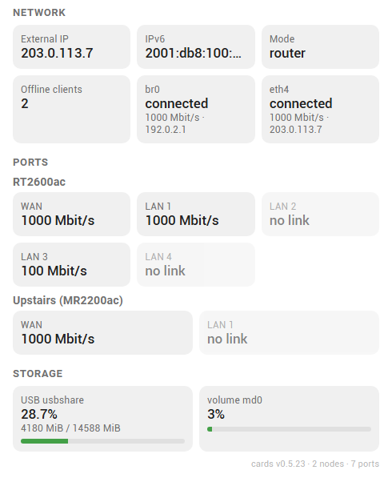
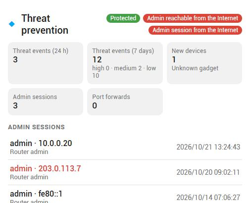
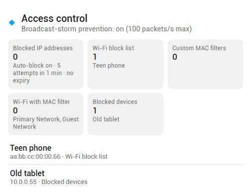
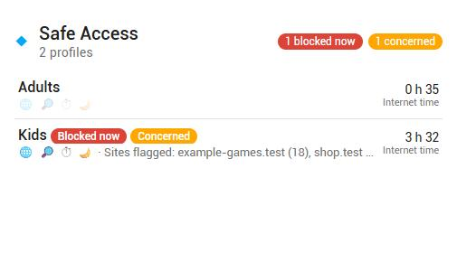

<p align="center">
  
</p>

# Synology SRM Plus

[](https://my.home-assistant.io/redirect/hacs_repository/?owner=infernalK&repository=ha-synology-srm-plus&category=integration)
[](https://github.com/infernalK/ha-synology-srm-plus/actions/workflows/validate.yaml)
[](LICENSE)

[English](README.md) · **Français**

**Tout ce que sait votre routeur Synology, dans Home Assistant : santé, vrai trafic, Wi-Fi, chaque client, sécurité et contrôle parental, avec des cartes de tableau de bord prêtes à l'emploi.**

Développée et testée sur un **RT2600ac (SRM 1.3.2)**. L'intégration native `synology_srm` ne liste que les appareils connectés ; celle-ci expose le routeur lui-même. Elle cohabite avec l'intégration native (domaine différent) et se configure depuis l'interface.

## Ce que vous obtenez

| Groupe | Entités |
|---|---|
| Routeur | état, durée de fonctionnement, firmware, modèle, **débit réel** (rx / tx, trafic accéléré par le matériel compris), appareils connectés ; idem pour chaque **autre nœud** (point d'accès Wi-Fi / répéteur comme un MR2200ac) : état, durée de fonctionnement, firmware, modèle, appareils connectés, débit |
| CPU / mémoire | utilisation CPU, part utilisateur / système, charge moyenne (1 / 5 / 15 min), utilisation de la mémoire et du swap, détails mémoire (diagnostic) |
| Clients | clients en ligne, **un capteur par connexion** (Wi-Fi 2,4G, Wi-Fi 5G, Filaire) dont les attributs listent chaque client rattaché, **clients hors ligne avec leur dernière connexion**, téléchargement / envoi des clients (total et par connexion) |
| Wi-Fi | par bande : canal, débit, signal moyen, nombre de clients ; largeur / puissance / mode en attributs |
| Réseau | état de la connexion IPv4 / IPv6, mode réseau (routeur / bridge), IPv4 / IPv6 externes (+ noms DDNS), liens Ethernet (état, vitesse, IP) |
| Ports | vitesse et état du lien du port WAN et de chaque port LAN |
| Stockage | **utilisation du disque USB** (%, utilisé, total), activité des disques et volumes |
| Sécurité | menaces détectées (24 h / 7 jours), nouveaux appareils, sessions d'administration, IP bloquées et **appareils bloqués**, **liste de blocage Wi-Fi** (la liste système, valable pour tous les SSID, avec la prévention des tempêtes de diffusion), **filtres MAC personnalisés** et réseaux Wi-Fi qui en utilisent un, redirections de ports, protection contre les menaces activée ou non, **alertes** si l'interface d'administration est joignable depuis Internet ou si quelqu'un s'est connecté de l'extérieur |
| Safe Access (contrôle parental) | par profil : **ses appareils** (en ligne ou non, avec leur temps sur internet), temps sur internet, état, plage « bloqué en ce moment », filtres actifs, sites signalés ; chaque client indique aussi son profil |
| Optionnel | entités de présence (device trackers) pour les clients de votre choix, ou pour tous |

Fréquence de relevé : 60 secondes (les données qui changent peu sont lues moins souvent pour ménager le routeur). Tout est lu en local via l'API web de SRM (`https://<routeur>:8001`) avec la bibliothèque [synology-srm](https://github.com/aerialls/synology-srm).

Les modèles et firmwares SRM diffèrent : l'intégration lit la liste des API que votre routeur propose et **ne crée que les entités dont l'API existe**. Les autres sont ignorées sans erreur.

### Détail des clients

Chaque capteur de connexion (par exemple `sensor.<routeur>_clients_wi_fi_5g`) a un attribut `clients` : pour chaque appareil, son nom, sa MAC, ses IPv4 / IPv6, sa bande Wi-Fi, son SSID et son profil, son signal, son débit de lien, ses débits de téléchargement et d'envoi, son type d'appareil, le nœud du routeur et les indicateurs QoS / invité / bloqué / contrôle parental. Le capteur *Clients hors ligne* liste les appareils connus du routeur mais absents, avec l'heure de leur **dernière connexion** (conservée entre les redémarrages). Ces attributs ne sont pas enregistrés dans l'historique, donc pas de base de données gonflée.

Si vous préférez une entité par appareil, utilisez l'**option de suivi de présence** (*Configurer* sur l'intégration) : choisissez les clients qui reçoivent une entité de présence, ou suivez-les tous. Les clients décochés sont supprimés, sans entités fantômes. C'est la même idée que l'intégration native : n'en gardez qu'une des deux pour éviter les doublons.

Si vous n'utilisez pas Safe Access, décochez **Utiliser Safe Access** dans la même fenêtre *Configurer* : ses appels ne sont plus faits et ses entités sont supprimées.

Sur la carte *Contrôle d'accès*, `show_blocked_ips: false` masque la liste des adresses IP bloquées automatiquement et ne garde que leur nombre (pratique quand le routeur en bloque des dizaines de milliers) ; la liste est affichée par défaut.

## Cartes de tableau de bord

Cinq cartes sont fournies et chargées automatiquement (aucune ressource à ajouter) :

| Carte routeur | | Carte clients |
|---|---|---|
|  |  |  |

| Carte protection contre les menaces | Carte contrôle d'accès | Carte Safe Access |
|---|---|---|
|  |  |  |

*Rendu avec des données d'exemple neutres, en anglais. Dans Home Assistant, les icônes des clients sont des icônes Material Design (les émojis ici sont des substituts du banc d'essai) et les couleurs suivent votre thème. Les cartes s'affichent en français si Home Assistant est en français.*

```yaml
type: custom:synology-srm-router-card     # jauges, trafic, bandes, points d'accès Wi-Fi (répéteurs), ports, USB, stockage
```

```yaml
type: custom:synology-srm-clients-card    # chaque client, hors ligne compris
title: Clients
sort_by: download        # download | upload | signal | ip | name | last_seen
groups: [5G, 2.4G]       # filtre facultatif (aussi : Wired, Offline)
max_height: 500          # facultatif, en px
```

```yaml
type: custom:synology-srm-threat-card     # protection contre les menaces : événements, nouveaux appareils, sessions d'administration, exposition
```

```yaml
type: custom:synology-srm-access-card     # contrôle d'accès : IP bloquées (blocage auto), liste de blocage Wi-Fi, filtres MAC, appareils bloqués
show_blocked_ips: false                   # facultatif : masque la liste des IP bloquées, garde seulement leur nombre (défaut : true)
```

```yaml
type: custom:synology-srm-safeaccess-card # Safe Access (contrôle parental) : temps sur internet, état, plages horaires par profil
```

Après la première installation, rechargez la page **sans cache** (Ctrl+Maj+R, ou Cmd+Maj+R sur Mac ; dans l'application mobile, *Paramètres → Application → Réinitialiser le cache du frontend*) pour que les cartes soient prises en compte. L'intégration affiche une notification pour vous le rappeler.

Les cartes retrouvent seules les entités de l'intégration ; ajoutez `device_id: <id>` si vous avez plusieurs routeurs. Dans la carte des clients, un clic déplie tous les détails d'un client, un double-clic ouvre son capteur de connexion. Un tableau de bord prêt à coller se trouve dans [dashboards/synology-srm.yaml](dashboards/synology-srm.yaml).

## Installation

### HACS

1. Dans HACS, recherchez **Synology SRM Plus** et téléchargez-le (ou utilisez le bouton en haut de cette page).
2. Redémarrez Home Assistant.
3. *Paramètres → Appareils et services → Ajouter une intégration → Synology SRM Plus*.

### Compte du routeur

Utilisez un compte **administrateur** du routeur (un compte dédié comme `ha` est recommandé). Le port par défaut est `8001` ; le certificat est généralement auto-signé, donc *Vérifier le certificat SSL* est désactivé par défaut.

## Unités et réserves

- **Le trafic des clients** additionne les valeurs `transferRXRate` / `transferTXRate` de chaque appareil. Pendant une vidéo 4K sur un client en 5 GHz, cet appareil indiquait environ 4,1 millions, ce qui correspond à des octets par seconde (~33 Mbit/s).
- **Le débit du routeur** (`rx` / `tx`) vient de la liste des nœuds et inclut le trafic que le routeur transfère en matériel. Synology ne documente pas le sens de `rx` et `tx` sur votre réseau.
- Les débits par interface (`br0`, `eth2`…) viennent de l'API d'utilisation système et sont restés proches de zéro pendant ce flux 4K : ils semblent ignorer le transfert accéléré par le matériel. Ils sont désactivés par défaut sur les nouvelles installations.
- Les tailles USB sont données en Mio (une clé de 32 Go affiche environ 29 000).
- Les charges moyennes sont fournies par SRM multipliées par 100 et sont divisées en retour.
- Le signal Wi-Fi est affiché en pourcentage ; Synology ne documente pas son échelle.
- Le temps sur internet de Safe Access est en minutes, sur une fenêtre de 24 heures (un appareil toujours en ligne affiche environ 24 h).
- **La dernière connexion** ne commence qu'à l'installation de l'intégration : les appareils déjà hors ligne n'ont pas de date avant de se reconnecter.

## Explorer votre routeur

Le routeur expose des centaines de points d'accès (API) et les modèles diffèrent. Pour cartographier ce que le vôtre propose, appelez le service `synology_srm_plus.explore_api` (*Outils de développement → Actions*, paramètre facultatif `filter` comme `Wifi`). Il tourne en arrière-plan quelques minutes, n'appelle que des méthodes en lecture seule (`get` / `list`), ignore tout ce qui pourrait avoir un effet de bord, et écrit ce qui répond dans le journal de Home Assistant (niveau INFO pour `custom_components.synology_srm_plus`).

Le journal est **masqué** : mots de passe, clés et codes PIN, noms de comptes et d'hôtes, SSID, adresses MAC et adresses IP publiques sont remplacés (les adresses privées sont raccourcies). Les noms qui ne sont pas sous une clé reconnue (par exemple les noms de profils) ne sont pas détectés : relisez avant de partager.

## Confidentialité

L'API de SRM reçoit le compte, le mot de passe et l'identifiant de session dans l'URL, et les bibliothèques HTTP citent les URL dans leurs erreurs et leurs journaux de débogage. Cette intégration les masque (`passwd=***`) dans ses propres messages et dans les journaux de `urllib3`, n'écrit jamais la trace d'une connexion échouée, et masque adresses, adresses MAC, noms et secrets dans le fichier de diagnostic. Les réglages des réseaux Wi-Fi sont réduits à des champs sans risque avant stockage, car les données brutes contiennent les mots de passe Wi-Fi.

## Aidez-nous à prendre en charge plus de modèles

Cette intégration a été construite sur un seul routeur : les retours d'autres modèles sont les bienvenus. Ouvrez un ticket avec le modèle fourni et joignez le **fichier de diagnostic** : *Paramètres → Appareils et services → Synology SRM Plus → ⋮ → Télécharger les diagnostics*. Il liste les API que votre routeur propose et les données brutes, avec adresses, noms d'hôtes, numéro de série et identifiants masqués. Relisez-le tout de même avant de le publier.

## Licence

MIT, voir [LICENSE](LICENSE).
