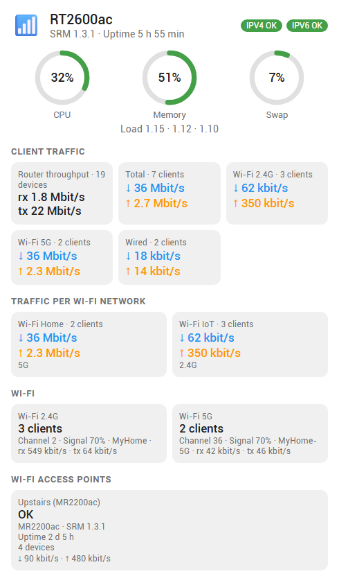
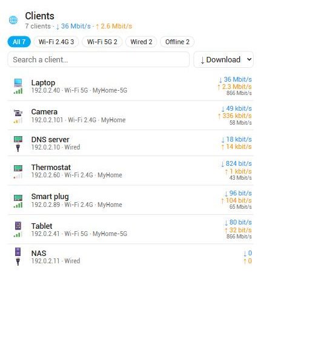

# Synology SRM Plus

Home Assistant custom integration for **Synology SRM routers** (developed and tested on an
RT2600ac, SRM 1.3.2). The built-in `synology_srm` integration only exposes the connected
devices; this one exposes data about **the router itself**.

It works alongside the built-in integration (different domain) and is configured from the UI.

## What you get

| Group | Entities |
|---|---|
| CPU | usage, user / system share, load average (1 / 5 / 15 min) |
| Memory | usage %, swap usage %, total / available / cached / buffers / swap (diagnostic) |
| Clients | online clients, **one sensor per connection** (Wi-Fi 2.4G, Wi-Fi 5G, Wired) whose attributes list every attached client, and client download / upload rates (total and per connection) |
| Connection | IPv4 / IPv6 status, network mode (router / bridge), external IPv4 / IPv6 (+ DDNS host names as attributes) |
| Ethernet links | status, speed, IP per active interface (mask, gateway, DNS, MTU… as attributes) |
| Wi-Fi | channel (+ BSSID) and average signal per band |
| Storage | utilization, read and write rate per disk and volume |
| Router | uptime, firmware, model (serial number in the device page) |
| Interfaces | per-interface rates (`br0`, `eth2`…), disabled by default, see *Units and caveats* |
| Diagnostic | number of live traffic entries (needs traffic statistics enabled on the router) |
| Optional | presence entities (device trackers) for the clients you choose, or for all of them: *Configure* on the integration → *Presence tracking* |

### Client details

Each connection sensor (e.g. `sensor.<router>_clients_wi_fi_5g`) has a `clients` attribute: a list with,
for every device, its name, MAC, IPv4 / IPv6, Wi-Fi band, SSID and profile, signal, link rate, download and
upload rates, device type, router node, and the QoS / guest / blocked / parental-control flags.
These attributes are kept out of the recorder (no database bloat).

If you prefer one entity per device, use the **presence tracking option** (*Configure* on the integration): pick
the clients that get a presence entity, or track every client. It is the same idea as the built-in integration,
so keep only one of the two if you do not want duplicates.

Polling interval: 60 seconds. Everything is read locally from the SRM web API
(`https://<router>:8001`), using the [synology-srm](https://github.com/aerialls/synology-srm) library.

SRM models and firmwares differ: the integration reads the list of APIs your router offers and
**only creates the sensors whose API exists**. Missing ones are skipped without errors.

## Exploring your router

The router exposes hundreds of API endpoints and models differ. To help map what yours offers, call the service
`synology_srm_plus.explore_api` (*Developer tools → Actions*, optional `filter` such as `Wifi`). It runs in the
background, calls only read-only `get` / `list` methods, skips anything that looks like it could have a side
effect, and writes what answers to the Home Assistant log (INFO level for `custom_components.synology_srm_plus`).
It takes a few minutes. Please share the relevant lines in an issue if you want a model supported.

## Dashboard cards

The integration ships two cards and loads them automatically (no resource to add).

| Router card | Clients card |
|---|---|
|  |  |

*Rendered with sample data. In Home Assistant the client icons are Material Design icons (the emoji
here are stand-ins used by the preview harness); the colors follow your theme.*

```yaml
type: custom:synology-srm-router-card     # CPU / memory gauges, traffic, Wi-Fi, network, storage
```

```yaml
type: custom:synology-srm-clients-card    # every client: signal, link rate, traffic, details on click
title: Clients
sort_by: download        # download | upload | signal | name
groups: [5G, 2.4G]       # optional filter (also: Wired)
max_height: 500          # optional, px
```

Both cards find the integration's entities on their own; add `device_id: <id>` if you have several routers.
Click a client to expand all its details, double-click to open its connection sensor. A ready-made
dashboard is in [dashboards/synology-srm.yaml](dashboards/synology-srm.yaml). The cards are in French or
English depending on your Home Assistant language.

## Install

### HACS (custom repository)

1. HACS → ⋮ → *Custom repositories* → add `https://github.com/infernalK/ha-synology-srm-plus`,
   category **Integration**.
2. Install **Synology SRM Plus** and restart Home Assistant.
3. *Settings → Devices & services → Add integration → Synology SRM Plus*.

### Router account

Use an **administrator** account on the router (a dedicated one such as `ha` is recommended).
Default port is `8001`; the certificate is usually self-signed, so *Verify SSL* is off by default.

## Units and caveats

- **Client traffic** sensors sum the per-device `transferRXRate` / `transferTXRate` reported by SRM
  (total, per Wi-Fi band, wired). While a 4K video played on one 5 GHz client, that device reported about
  4.1 million, consistent with bytes per second (~33 Mbit/s). Use these for real throughput.
- The per-interface rates (`br0`, `eth2`…) come from the system utilization API and **stayed near zero
  during that 4K stream**, so they appear to miss hardware-accelerated forwarding. They are disabled by
  default on new installs.
- Disk rates are assumed to be in bytes per second (not verified).
- Load averages are reported by SRM multiplied by 100 and are divided back.
- The Wi-Fi signal value is shown as a percentage; Synology does not document its scale.

## Help us support more models

This was built on a single router, so feedback from other models is very welcome.
Open an issue using the template and attach the **diagnostics file**:
*Settings → Devices & services → Synology SRM Plus → ⋮ → Download diagnostics*.
It lists the API names your router offers and the raw payloads, with MAC / IP addresses,
host names, serial number and credentials redacted. Please still skim it before posting.

## License

No license has been chosen yet.
